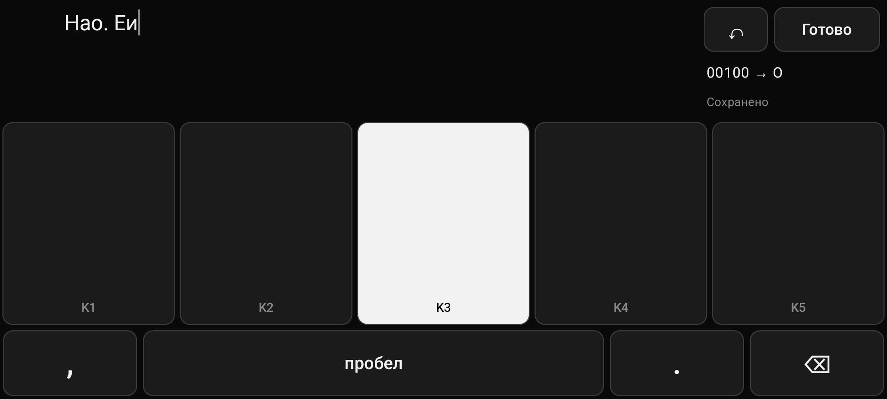

# MorsePad

Минималистичное Android-приложение для быстрых текстовых заметок. Текст набирается аккордами —
одновременными нажатиями пяти сенсорных клавиш; каждая комбинация из пяти битов даёт одну букву.
Пробел, запятая и точка — отдельные клавиши. Работает полностью офлайн.

* Основная платформа: Android 8.0+ (minSdk 26), целевой API 34
* Kotlin 2.0, Jetpack Compose, Room/SQLite, Kotlin Coroutines
* Кодировка v1.0 по ТЗ, Ф и Ъ — через префикс `11111`



Документация:

* [docs/ARCHITECTURE.md](docs/ARCHITECTURE.md) — структура проекта и принцип работы кодировки
* [docs/MULTITOUCH_TEST_REPORT.md](docs/MULTITOUCH_TEST_REPORT.md) — тестирование мультитача
* [docs/LATENCY_REPORT.md](docs/LATENCY_REPORT.md) — измерение задержек

## Установка готовой сборки

Готовые APK лежат в `dist/` (после сборки скриптом, см. ниже):

```bash
adb install -r dist/MorsePad-1.0-release.apk
```

Release-сборка оптимизирована R8 и подписана debug-ключом — ставится напрямую для тестирования.
Для распространения подпишите её своим ключом (`signingConfig` в `app/build.gradle.kts`).

При первом входе на экран ввода Android один раз показывает системную подсказку
«Полноэкранный режим / Viewing full screen» — нажмите «ОК». Больше она не появляется.

## Сборка из исходников

Требуется:

* JDK 17 или 21 (подойдёт встроенный в Android Studio JBR; **Java 22+ не поддерживается Gradle 8.9**)
* Android SDK с платформой `android-34` (Android Studio ставит её сама)

### Скриптом (рекомендуется)

```bash
scripts/build-apk.sh
```

Скрипт сам находит JDK Android Studio и Android SDK, прогоняет unit-тесты ядра и кладёт
`MorsePad-1.0-release.apk` и `MorsePad-1.0-debug.apk` в `dist/`. Флаг `--skip-tests` пропускает тесты.

### Вручную

```bash
export JAVA_HOME="/Applications/Android Studio.app/Contents/jbr/Contents/Home"
```

```bash
./gradlew :core:test :app:assembleDebug :app:assembleRelease
```

APK: `app/build/outputs/apk/{debug,release}/`. Если SDK не найден, создайте `local.properties`
со строкой `sdk.dir=/путь/к/Android/sdk`.

### Android Studio

`File → Open` → папка проекта → дождаться синхронизации Gradle → Run `app`.

## Тесты

| Набор | Где | Команда |
|---|---|---|
| Кодировка, движок ввода, редактор, сессия, автосохранение, статистика (JVM) | `core/src/test` | `./gradlew :core:test` |
| Мультитач панели, сквозные сценарии, Room, конвейер ввода и задержки (устройство/эмулятор) | `app/src/androidTest` | `./gradlew :app:connectedDebugAndroidTest` |

Отдельный инструментальный класс:

```bash
./gradlew :app:connectedDebugAndroidTest -Pandroid.testInstrumentationRunnerArguments.class=com.morsepad.app.InputPipelineLatencyTest
```

## Как пользоваться

* Список заметок: поиск по тексту, «Новая заметка», удаление с подтверждением, шестерёнка — настройки.
* Экран ввода (альбомная ориентация, системные панели скрыты):
  * сверху — текст заметки, справа — ↶ (отмена), «Готово», подсказка набираемого аккорда и статус сохранения;
  * в центре — клавиши K1…K5; символ фиксируется, когда отпущен последний палец;
  * снизу — запятая, пробел, точка, ⌫ (удержание — повтор).
* Первая буква заметки и буква после точки — заглавные автоматически.
* Ф: `●●●●●`, затем `○●○○○`. Ъ: `●●●●●`, затем `●○○○○`.
* Таблица кодов с точечной схемой — в «Настройки → Кодировка».
* Задержки ввода собираются во время набора: «Настройки → Диагностика задержек» (кнопка «Сохранить CSV»).

## Структура репозитория

```
core/                       чистый Kotlin, без Android
  codec/                    ChordMask, ChordTable(+валидатор, реестр), ChordTableV1 (данные), ChordCodec, ChordSequenceDecoder
  input/                    InputEngine — сбор и фиксация аккордов
  editor/                   TextEditor — текст, авторегистр, удаление, отмена
  session/                  TypingSession — связка ввода и редактора, правила префикса
  notes/                    Note, NoteRepository, NoteAutosaver, заголовки, поиск
  settings/                 AppSettings, SettingsRepository
  diagnostics/              LatencyStats — окно сэмплов и перцентили
app/
  data/                     Room: сущности, DAO, репозитории, WriteBarrier
  ui/editor/                экран ввода: ChordPad, PadKey, NoteTextArea, EditorScreen, NoteViewModel
  ui/notes/ ui/settings/    список заметок, настройки
  diagnostics/              LatencyTracker (касание → отрисовка → кадр), CSV-отчёт
  schemas/                  экспортированная схема БД (для будущих миграций)
docs/                       архитектура, отчёты
scripts/build-apk.sh        сборка APK
```
